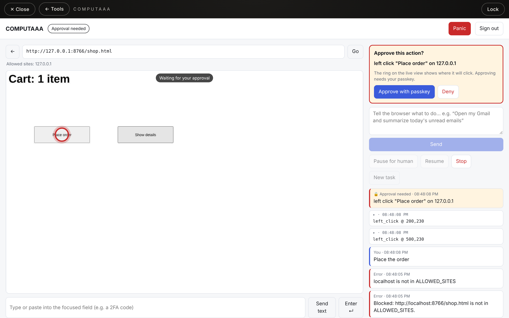
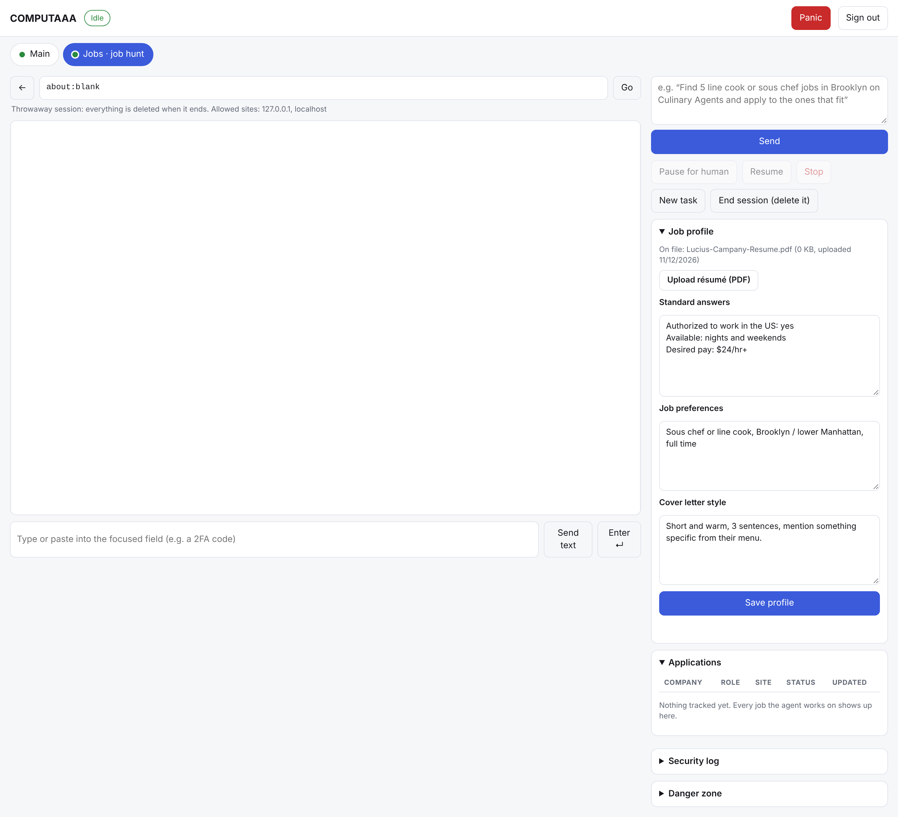

# COMPUTAAA

Your browser, on command. You type what you want done in the owner panel of luciuscampany.com, and Claude carries it out in a real Chromium browser that stays logged in to your accounts. You watch it live, take over whenever you like, and approve anything risky with your passkey.





> **This folder is not part of the website.** Netlify publishes this repo, so `_redirects` returns a 404 for `/COMPUTAAA/*`. COMPUTAAA runs on its own server at `agent.luciuscampany.com`. The website only has the tile that opens it (`owner.js`).

## How it's built

```
cloudflared ──edge── control ──internal── worker-main ──egress── websites
                                    └──── worker-jobs ──egress── job sites
```

| Part | Holds | Doesn't hold |
|---|---|---|
| **control** (`src/server.js`) | Dashboard, passkeys, approvals, security log, the Claude agent loop, the API key | No browser, no saved logins |
| **worker-main**, **worker-jobs** (`src/worker.js`) | One Chromium profile each, with that agent's logins; each enforces its own site allowlist | No API key, no passkeys, no dashboard, no open port, and no access to each other |
| **cloudflared** | The outbound tunnel to Cloudflare | Can't reach the worker at all |

Each worker connects *out* to the control plane over a private network with its own secret (`WORKER_TOKEN_MAIN`, `WORKER_TOKEN_JOBS`), so one can never pose as another, and only runs actions from a fixed list. A break-in at the control plane doesn't reach your logins; a hijacked browser can't see the API key or grant itself approvals. This is phase 1 of the plan: later phases add a lead agent and more workers (one per area of your life).

## The agents

The dashboard has a tab per agent. Each has its own browser, logins, allowed sites and conversation.

### Main
General tasks on the sites in `ALLOWED_SITES`.

### Jobs
Finds jobs and fills in applications from your **Job profile** (open it on the Jobs tab):

- **Résumé:** upload a PDF; uploading again replaces it straight away.
- **Standard answers:** work authorization, availability, pay, start date, contact details…
- **Job preferences:** roles, places, schedule, minimum pay, deal-breakers.
- **Cover letter style:** paste one you like or describe the tone.

Changes apply from the agent's next task. It never stores or types your Social Security number, date of birth, bank details or passwords; it stops and asks you.

**Who clicks Submit depends on the site** (`JOBS_FILL_ONLY_SITES`):

| Sites | What happens at the final submit |
|---|---|
| LinkedIn, Indeed, Glassdoor, Craigslist | Their rules ban bots, so the agent fills everything, then **hands the Submit to you**: a ring shows the button, you click it in the live view (or don't), and press Done. The agent's own click is never made. |
| Culinary Agents, company career sites (Greenhouse, Lever, Workday, Harri…), Gmail | The agent submits or sends, **after your passkey tap**. |

Every job it touches lands in the **Applications** tracker (found → filled → waiting on you / submitted / skipped), so it never applies twice. Moving through a form ("Easy Apply", "Next", "Continue", "Review", "Upload résumé") doesn't ask; the final send always does.

### Throwaway sessions
Set `JOBS_EPHEMERAL=true` (or `MAIN_EPHEMERAL=true`) and that agent starts every session with an empty browser, asks you to sign in when a site needs it, and **deletes everything** (cookies, logins, history) when you press **End session**, when it goes idle, or on Panic. Nothing is left on disk. The trade-off: you sign in, often with 2FA, every session, and sites may send more "new device" emails.

## Cost (estimate)

| | Monthly |
|---|---|
| Server, 8 GB (Hetzner; check current prices) | ~$8–18 |
| Cloudflare tunnel + Access, ntfy alerts | $0 |
| Claude API (Opus 5.5), billed separately from a Claude subscription | ~$1–1.50 per job application, ~$0.25–1 per everyday task |

Roughly **$40–60/month** for light use (~20 applications plus a few tasks a week), **$100–140** for regular use. Set a spending limit on the API key.

## How it's protected

Each layer assumes the one before it might fail.

| # | Layer | Where | What it stops |
|---|---|---|---|
| 0 | Owner PIN on the website | `owner.js` | Hides the tile from visitors. **Not security**: it's checked in the visitor's browser and can be guessed offline. Everything below is the real lock. |
| 1 | **Cloudflare Tunnel + Access** | Cloudflare + `src/auth.js` | The server has no open ports. Cloudflare only lets your email through, and the app re-checks Cloudflare's signed token on every request and connection, so getting around the tunnel gets you nothing. |
| 2 | **Passkey sign-in** (Face ID / Touch ID / security key) | `src/auth.js` | Phishing and stolen passwords; there's no password to steal. Eight single-use recovery codes are your backup. Sessions end after 30 min idle or 8 h. |
| 3 | **Approvals enforced by code** | `src/agent.js` | Before every click or Enter, the server reads what's under the cursor or in focus. Buy, send, post, delete, submit, confirm, sign, save, and clicks inside embedded payment frames all wait for a **fresh passkey tap**. A web page can trick the AI into *trying*; it can't skip this check. |
| 4 | **Site allowlist** | `src/browser.js` | The browser can only open sites in `ALLOWED_SITES`, for the agent and for you. That stops hijack attempts from sending your data to an attacker's site. |
| 5 | **Isolation** | `docker-compose.yml` | Logins live only in the worker, the API key only in the control plane, on separate networks. Read-only containers, no Linux capabilities, memory and process limits, no ports, data on an encrypted folder. The browser closes after 30 idle minutes. |
| 6 | **Panic button + wipe** | dashboard | Panic stops the agent, closes the browser, and signs out every session. "Wipe saved logins" (passkey required) deletes the whole browser profile. |
| 7 | **Security log + phone alerts** | `src/audit.js` | Every sign-in, command, approval, denial and blocked site is written to `data/audit.log` and shown in the dashboard. Important events also ping your phone via ntfy. |

### What's still on you (honest limits)

- **Approval rules are pattern-based.** They catch the usual risky buttons and keys, but a site with an oddly labelled "Buy" button could slip past. That's why the allowlist and the next point matter.
- **Keep high-value accounts out.** Don't log this browser into your bank or your main email unless you need to. A separate Google account for COMPUTAAA work is the safest setup.
- **Your recovery codes are as powerful as your passkey.** Keep them offline.
- **Set a spending limit** on the Anthropic API key (Console → Settings → Limits).
- **Anyone who controls your Cloudflare account controls layer 1.** Turn on a passkey or security key for your Cloudflare login too.

## Deploy it (about an hour, once)

### 1. Rent and lock down a VPS
A Hetzner CX22 or DigitalOcean 4 GB droplet with Ubuntu 24.04 is plenty.
```bash
# as root on the new server
adduser lucius && usermod -aG sudo lucius
# copy your SSH key to lucius, then in /etc/ssh/sshd_config set:
#   PasswordAuthentication no   PermitRootLogin no
systemctl restart ssh
apt update && apt install -y unattended-upgrades ufw gocryptfs docker.io docker-compose-v2 git
ufw default deny incoming && ufw allow OpenSSH && ufw enable   # the tunnel needs NO inbound ports
```

### 2. Get the code
```bash
git clone https://github.com/lucius2882-lang/claude.git && cd claude/COMPUTAAA
cp .env.example .env && chmod 600 .env
```

### 3. Encrypted storage for your logins
```bash
sudo mkdir -p /srv/computaaa/vault /srv/computaaa/data
sudo gocryptfs -init /srv/computaaa/vault          # choose a long passphrase; save the master key it prints, offline
sudo gocryptfs -allow_other /srv/computaaa/vault /srv/computaaa/data
sudo mkdir -p /srv/computaaa/data/control /srv/computaaa/data/worker-main /srv/computaaa/data/worker-jobs
# give each folder to its container's user (check the numbers with the two commands below)
docker compose run --rm --no-deps control id -u        # usually 1000
docker compose run --rm --no-deps worker-main id -u    # usually 1001
sudo chown 1000 /srv/computaaa/data/control && sudo chown 1001 /srv/computaaa/data/worker-main /srv/computaaa/data/worker-jobs
```
After every reboot, the data stays locked until you SSH in and run the `gocryptfs … /srv/computaaa/data` line again. That's deliberate: a stolen disk or snapshot is useless.

### 4. Cloudflare (free plan)
1. Add `luciuscampany.com` to Cloudflare and switch your domain's nameservers to Cloudflare's. Recreate the DNS records that point the website at Netlify (Cloudflare usually imports them), and the website keeps working.
2. **Zero Trust → Networks → Tunnels → Create tunnel** (type *Cloudflared*). Copy the token into `.env` as `CLOUDFLARE_TUNNEL_TOKEN`. Add a public hostname `agent.luciuscampany.com` → `http://control:3000`. (Never route port 3001; that's the private worker channel.)
3. **Zero Trust → Access → Applications → Add → Self-hosted**, domain `agent.luciuscampany.com`.
   - Policy: **Allow**, Include → **Emails** → your email only.
   - Session duration: 24 hours.
   - Advanced → Cookies: SameSite **Lax**, HttpOnly on. This lets the dashboard load inside your owner panel.
   - Copy the **Application Audience (AUD) tag** into `.env` as `CF_ACCESS_AUD`, and your team domain (`<team>.cloudflareaccess.com`) as `CF_ACCESS_TEAM_DOMAIN`.
4. Turn on a passkey or security key for your Cloudflare account login.

### 5. Fill in `.env`
`OWNER_EMAIL`, `ANTHROPIC_API_KEY`, `WORKER_TOKEN_MAIN` and `WORKER_TOKEN_JOBS` (run `openssl rand -hex 32` once for each), `ALLOWED_SITES` for Main (start small, e.g. `google.com`), and optionally `NTFY_URL` for phone alerts. `JOBS_ALLOWED_SITES` comes filled in with job boards and the common application systems; add any company site you want it to apply on. Docker gives each worker only its own token and sites, never the API key. Leave `PUBLIC_ORIGIN` and `FRAME_ANCESTORS` as they are unless your domain differs.

### 6. Start it and create your passkey
```bash
docker compose up -d --build
docker compose exec control node scripts/enroll.js
```
Open the printed link on your phone (it works once, for 15 minutes), create the passkey, and **write down the 8 recovery codes**. To add a second device later, run the enroll command again.

### 7. Log in to your accounts once
Open the owner panel → COMPUTAAA. Type the site in the address bar, click into the live view and log in. Use the "Type" box for passwords and 2FA codes. Sessions are saved on the encrypted disk.

## Using it

- **Send a command**, e.g. "Open Gmail and summarize today's unread emails."
- **Pause for human** hands you the controls. **Stop** ends the task. **New task** clears the conversation.
- The agent pauses by itself for logins, 2FA and CAPTCHAs ("The agent needs you").
- **Approval needed**: a red ring shows where it wants to click. Approve with your passkey, or Deny.
- **Panic** (top right) shuts everything and signs you out everywhere.

## Updating

```bash
cd claude && git pull && cd COMPUTAAA && docker compose up -d --build
```
When you change the `playwright` version in `package.json`, change the image tag in `Dockerfile.worker` to match.

## Local development

```bash
npm install && npx playwright install chromium
cp .env.example .env    # set PUBLIC_ORIGIN=http://localhost:3000, CF_ACCESS_DISABLED=true, WORKER_TOKEN
npm start               # terminal 1: control plane
WORKER_NAME=main WORKER_TOKEN=$WORKER_TOKEN_MAIN npm run worker   # terminal 2
WORKER_NAME=jobs WORKER_TOKEN=$WORKER_TOKEN_JOBS ALLOWED_SITES=$JOBS_ALLOWED_SITES PROFILE_DIR=./data/jobs-profile npm run worker   # terminal 3
npm run enroll          # prints your passkey link
```
`CF_ACCESS_DISABLED` is refused for anything but `http://localhost`.

## Files

| File | Purpose |
|---|---|
| `src/server.js` | Control plane: HTTP + WebSocket server, worker channel, panic, wipe, idle sleep |
| `src/worker.js` | Browser worker: runs the allowed browser actions the control plane asks for |
| `src/remote.js` | The control plane's handle on a worker |
| `src/jobs.js` | Job profile, résumé and application tracker (control plane only) |
| `src/auth.js` | Cloudflare Access check, passkeys, recovery codes, sessions, step-up approvals |
| `src/agent.js` | Claude agent loop (`claude-opus-5-5`, computer use toolset) and the approval rules |
| `src/browser.js` | Persistent Chromium profile, site allowlist, live view, input (runs in the worker) |
| `src/audit.js` | Security log and ntfy alerts |
| `public/` | Dashboard, sign-in, passkey enrollment and approval pages |
| `scripts/enroll.js` | Prints a one-time passkey enrollment link |
